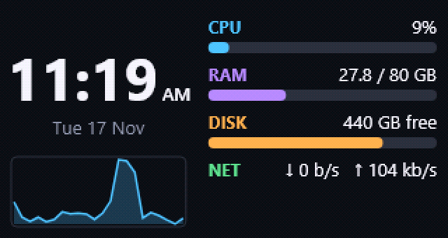
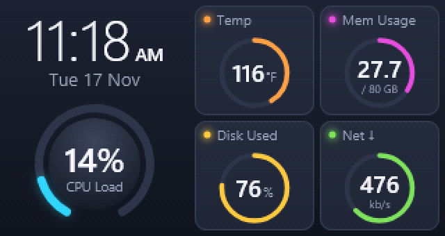
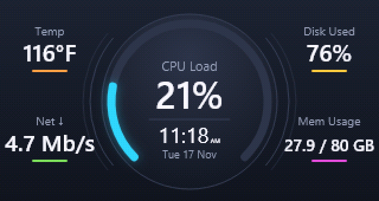
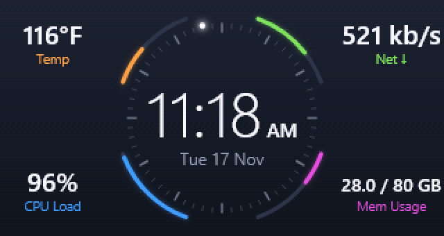
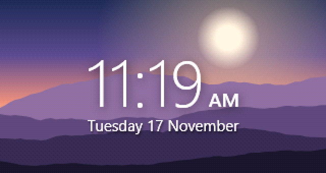
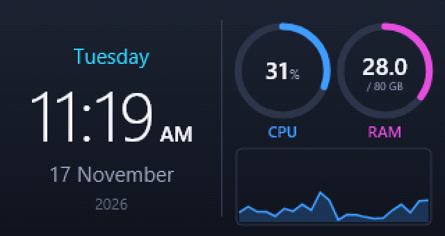
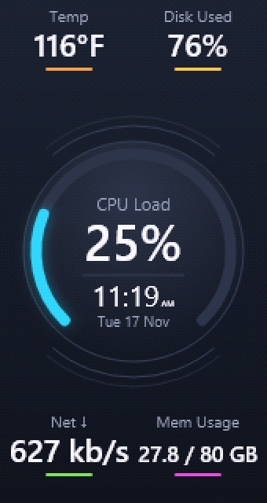
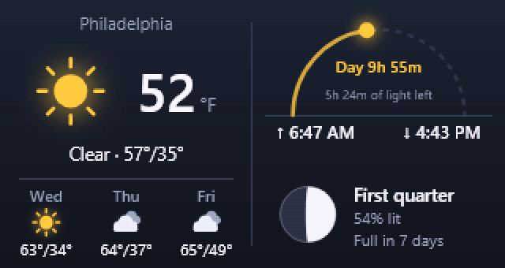
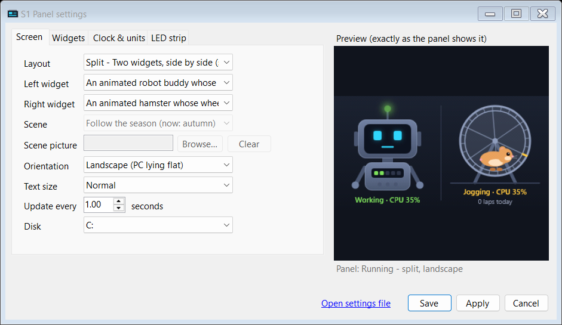

# S1 Panel

Software for the **AceMagic S1** mini PC's front LCD (320×170) and LED strip, as a replacement for AceMagic's own panel software, for Windows 10 and 11.

It needs **no administrator rights, no drivers and no background service**: just two programs in a folder.

  
  &nbsp;
  

## Download

Get `s1panel-windows-x64.zip` from the [latest release](https://github.com/dopazz/AceMagic_S1_Panel/releases/latest) (Windows 10 2004 or later, x64).

1. Quit or uninstall AceMagic's panel software, which holds the panel open.
2. Extract the zip somewhere permanent, such as `C:\S1_Panel`, and run `s1panel-tray.exe`.
3. The programs aren't signed, so Windows may show "Windows protected your PC": choose **More info**, then **Run anyway**.

To remove S1 Panel, turn off "Start with Windows" in its tray menu, exit it, and delete the folder.

## Features

- **Layouts:** dashboard, tiles, gauges, clock, seasonal scenes, split screen, and blank.
- **Split-screen widgets:** clock, CPU/RAM, weather, sunrise/sunset with moon phase, photo slideshow, Now Playing, and two animated buddies (a robot and a hamster) that react to CPU load.
- **LED strip:** rainbow, breathing, color cycle, auto, or off.
- **Lights Out:** black screen and LED strip off, from the tray menu.
- **Tray app:** a settings window with a live preview of the panel, quick layout switching, and Start with Windows.
- **Command line:** `s1panel.exe` for scripts, with the same settings file as the tray app.

### Layouts

Every layout works in landscape and portrait, for an S1 lying flat or standing up.

| Tiles | Gauge | Clock |
|:--:|:--:|:--:|
|  |  |  |
| **Scene** | **Split** | **Dashboard** |
|  |  |  |

   
  <em>The gauge layout in portrait</em>

### Widgets

The split layout shows any two widgets side by side. The robot's mood and the hamster's running speed follow your CPU load.

  
  &nbsp;
  

### Settings

Click the tray icon for the settings window, which shows a live preview of exactly what the panel will display.

  

Weather comes from [Open-Meteo](https://open-meteo.com/) (CC BY 4.0). Only your location's coordinates, or the place name you enter, are sent.

## Why the programs are large

Each exe has .NET built in (about 63 MB for the tray app and 50 MB for the command line), because installing .NET would need administrator rights. The zip's `README.txt` lists what takes the space.

## Building from source

The source is in [`src/`](src/); [`src/README.md`](src/README.md) covers building, the command line and every setting. You need the .NET 10 SDK. `packaging\windows.cmd` runs the tests and builds the distribution zip.

## Thanks

S1 Panel is built upon the work shared by tjaworski at [AceMagic-S1-LED-TFT-Linux](https://github.com/tjaworski/AceMagic-S1-LED-TFT-Linux), which worked out how the S1's panel and LED strip are driven. Many thanks for figuring it out and sharing it. See [CREDITS.md](CREDITS.md) for the components built into S1 Panel.

If S1 Panel is useful to you, you can [buy me a coffee on Ko-fi](https://ko-fi.com/ddopaz).

## License

Copyright (C) 2026 dopaz. S1 Panel is free software under the [GNU General Public License, version 3 or later](LICENSE), and comes with no warranty.

AceMagic is a trademark of its owner; S1 Panel is an unofficial project.

Developed with Claude Code (Claude Opus 5.5).
